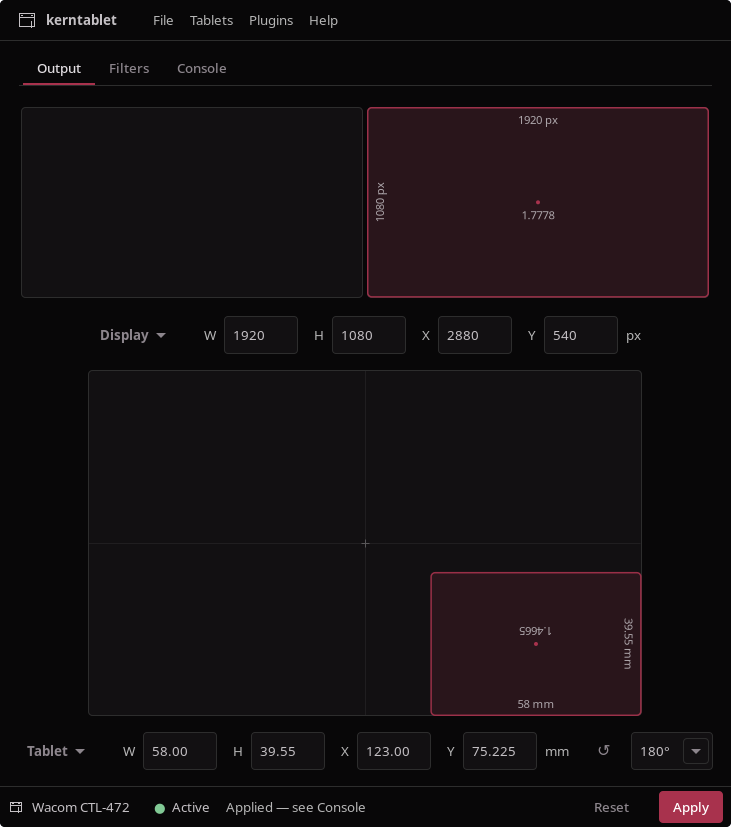

# kerntablet

Tablet area mapping for Wacom tablets that runs **in the kernel** — an
OpenTabletDriver replacement with no driver process in the pen's path. The
settings window only writes a few numbers into the kernel and can be closed;
the pen keeps working exactly as configured.

Works on any Wayland compositor and on Xorg. Made with osu! in mind,
including osu! under Wine.



> **Status:** early, single-developer project. Tested on one CTL-472 under
> Hyprland on Arch Linux. Everything else listed below is implemented but
> untested — reports from other setups are very welcome.

## Installation

You need:

- a kernel with HID-BPF: Linux 6.11 or newer with `CONFIG_HID_BPF=y` (Arch's
  `linux` and `linux-zen` have it);
- `rust`, `clang`, `llvm`, the `libelf` and `zlib` headers, and GTK 3
  (`gtk3` on Arch, `libgtk-3-dev` on Debian/Ubuntu).

```
git clone https://github.com/freed0my/kerntablet && cd kerntablet
cargo build --release
sudo ./install.sh
kerntablet
```

The last command opens the settings window: set your areas and press
**Apply**. That is all — from now on the tablet gets these settings every
time it is plugged in and every time you log in.

- Run `sudo ./install.sh` in a regular terminal; it can be run again at any
  time (after an update: `git pull && cargo build --release && sudo ./install.sh`).
- If OpenTabletDriver is installed, the installer disables its service. If
  your compositor or session config starts `otd-daemon` itself, the
  installer prints the lines to remove — it never edits your configs.
- Disabling libinput's own pen smoothing takes effect after you log in again.
- Check that everything works with `kerntablet status`; it should say
  *Active in kernel*.

To remove kerntablet: `sudo ./uninstall.sh`,
then replug the tablet. Your settings in `~/.config/kerntablet/` are kept.

## Where it works

### Tablets

| Model | Name | USB id | Tested |
|---|---|---|---|
| CTL-472 | One by Wacom S | `056a:037a` | yes |
| CTL-672 | One by Wacom M | `056a:037b` | no |
| CTL-480 | Intuos Pen S | `056a:030e` | no |
| CTL-470 | Bamboo Connect | `056a:00dd` | no |

All of them use the same pen report format. If you own one of the untested
models, please report whether it works. Other tablets need a little code —
see [Supporting more tablets](#supporting-more-tablets).

### Desktops

The area mapping itself works everywhere. What differs between desktops is
**binding the tablet to one monitor**, which matters with several monitors
(and is required for osu! under Wine, see
[Binding to a monitor](#binding-to-a-monitor)):

| Session | Binding to a monitor |
|---|---|
| Hyprland | automatic (tested) |
| sway | automatic |
| KDE Plasma | automatic |
| GNOME | automatic |
| Xorg (i3, XFCE, …) | automatic |
| other Wayland compositors (niri, river, Wayfire, …) | set it in the compositor yourself |

The settings are applied at every login automatically on GNOME, KDE Plasma,
any session started through uwsm or with systemd integration, and desktops
that run XDG autostart. A bare compositor or window manager needs one line
in its config — see [Applying at login](#applying-at-login).

## Filters

Filters (smoothing, prediction and the like) are **plugins**, as in
OpenTabletDriver: nothing beyond the area mapping runs unless you install
it. A plugin runs in the kernel too, right before the area mapping.

Install one from its directory, then tick it on the **Filters** tab and
press Apply:

```
kerntablet plugin install ./path/to/plugin    # a directory with plugin.toml
kerntablet plugin list                        # installed plugins
kerntablet plugin remove <id>
```

Installing needs the administrator password, since a plugin is code that
runs in the kernel; the loader refuses anything that is not a pen filter.
Plugins can also be installed by id from a repository (Plugins → Plugin
manager in the window, or `kerntablet plugin install <id>`) once you point
kerntablet at one — see [PLUGINS.md](PLUGINS.md#passing-a-plugin-on).

**Why OpenTabletDriver's filters are not included.** They are .NET code, so
they cannot run in the kernel and each one has to be rewritten. That part
is doable. The real obstacle is licensing: most OTD filters are GPL-3.0,
kerntablet is GPL-2.0-only, so a rewrite of one cannot be shipped as part of
kerntablet. Such ports have to be published separately, under the original
filter's license.

Writing a plugin, including rewriting an OTD filter for your own use:
[PLUGINS.md](PLUGINS.md).

## Everyday use

| What you want | How |
|---|---|
| Change the areas | `kerntablet`, change them, **Apply** |
| Re-apply after a monitor change | `kerntablet apply` (or Apply in the window) |
| Check that everything works | `kerntablet status` |
| Take the areas from OpenTabletDriver | `kerntablet import-otd`, or File → Import from OpenTabletDriver |
| Turn a filter on or off | Filters tab, or `kerntablet plugin enable <id>` / `disable <id>` |

Things to know:

- Areas are set the OpenTabletDriver way: **X and Y are the centre** of the
  area, the tablet in millimetres, the screen in pixels from the top-left
  corner of the whole desktop. Numbers from OTD carry over 1:1.
- Changes reach the tablet only when you press **Apply**; closing the window
  without applying forgets them. **Reset** goes back to what was applied.
- **After changing the monitor layout** (a monitor plugged in or out, a new
  resolution or position) run `kerntablet apply` or press Apply. An open
  window notices the change and reminds you.

## Binding to a monitor

Without binding, the compositor stretches the tablet over the whole desktop
and the kernel cuts your screen area out of that. The cursor lands in the
right place, but programs that read the tablet's coordinates themselves —
Wine's raw input, and so osu! under Wine — see the area as a slice of one
big screen spanning all monitors. Binding the tablet to the monitor your
area is on fixes that.

It only matters with more than one monitor, when the screen area lies on one
of them. Set it in the window: **Display ▾** (or right-click the monitors) →
Monitor binding:

| Mode | What happens |
|---|---|
| **Automatic** (default) | kerntablet binds the tablet to that monitor through the compositor's own interface |
| **Manual** | you bound it in your compositor's settings yourself; kerntablet only computes the mapping for that monitor |
| **Off** | no binding; the area is cut out of the whole desktop |

kerntablet uses only each compositor's official interface

| Session | Interface | Survives |
|---|---|---|
| Hyprland | `hyprctl eval` / `hyprctl keyword device[…]:output` | until the config is reloaded — see below |
| sway | `swaymsg input <id> map_to_output` | until the config is reloaded — see below |
| KDE Plasma | KWin's `outputName` over D-Bus | yes (same as System Settings → Drawing Tablet) |
| GNOME | gsettings `org.gnome.desktop.peripherals.tablet output` | yes (same as Settings → Wacom Tablet) |
| Xorg | `xinput map-to-output` | until the device reappears; re-applied at login |

Hyprland and sway forget runtime settings when their config is reloaded. To
keep the binding, source the file kerntablet keeps up to date — add **one**
line to your config:

```lua
-- hyprland.lua
pcall(dofile, os.getenv("HOME") .. "/.config/kerntablet/hyprland.lua")
```

```ini
# hyprland.conf
source = ~/.config/kerntablet/hyprland.conf
```

```
# sway
include ~/.config/kerntablet/sway.conf
```

## Applying at login

The monitor layout is only known inside a graphical session, so
`kerntablet apply --settle` runs at every login (it also keeps watching the
layout for a few seconds while the session starts up). The installer sets
this up system-wide:

| Session | What starts it |
|---|---|
| GNOME, KDE Plasma, anything started through uwsm, sway/Hyprland with systemd integration | `kerntablet-apply.service` via `graphical-session.target` |
| XFCE, LXQt and other desktops that run XDG autostart | `/etc/xdg/autostart/kerntablet-apply.desktop` |
| a bare compositor or window manager (i3, Hyprland/sway/niri started directly) | nothing — add the line below |

`systemctl --user is-active graphical-session.target` prints `active` if your
session is covered. If not, add to your compositor's autostart:

```
hl.exec_cmd("kerntablet apply --settle")         -- Hyprland, Lua config
exec-once = kerntablet apply --settle            # Hyprland, hyprland.conf
exec kerntablet apply --settle                   # sway
exec --no-startup-id kerntablet apply --settle   # i3
```

To turn it off for your user: `systemctl --user mask kerntablet-apply.service`.

## Troubleshooting

Start with `kerntablet status`; its *Status* line tells you where the
problem is:

| Status | What to do |
|---|---|
| Active | All good. If the cursor goes to the wrong place, see below |
| Tablet not connected | Check the cable: `lsusb \| grep 056a` |
| Tablet is bound to driver "hid-generic" | The `wacom` module is not loaded: `sudo modprobe wacom`; if that does not help, `sudo ./install.sh` |
| BPF program is not loaded | `sudo kerntablet-loader attach-all`, or replug the tablet |
| No access to the in-kernel settings | You are not in the `input` group (check with `id`); add yourself and log in again |

- **The cursor goes to the wrong place or monitor.** The monitor layout
  changed: `kerntablet apply`.
- **Stopped working after a kernel update.** If `kerntablet status` says the
  program is not loaded, `sudo kerntablet-loader attach-all`; if the loader
  then complains, rebuild: `cargo build --release && sudo ./install.sh`.
- **More details:** `journalctl -b -u 'kerntablet@*'`,
  `sudo kerntablet-loader status`, and the window's Console tab.

## How it works

```
tablet ──USB──► [ kerntablet core → plugins → area mapping ] ──► wacom driver ──► libinput ──► desktop
                         in the kernel           ▲ reads its settings
   kerntablet (window, `apply`) ─────────────────┘ writes them on Apply
```

1. The tablet is handled by the stock kernel driver `wacom`.
2. A small HID-BPF program sits in front of it and rewrites the coordinates
   of every pen report — area, rotation, clipping, one matrix multiply.
   Installed plugins run just before that.
3. `kerntablet-loader` (root) loads the program when the tablet is plugged
   in, then exits.
4. `kerntablet` computes the matrix from your areas and the monitor layout
   and writes it into the kernel; that needs no root, only the `input`
   group.

The matrix depends on the monitor layout, which is why a layout change
needs `kerntablet apply`.

### Where things live

| Path | What it is |
|---|---|
| `~/.config/kerntablet/config.toml` | areas and options; can be edited by hand, then `kerntablet apply` |
| `~/.config/kerntablet/plugins.toml` | filter settings, plugin repository |
| `~/.config/kerntablet/hyprland.lua`, `hyprland.conf`, `sway.conf` | monitor binding for your compositor config to source (optional) |
| `/usr/local/bin/kerntablet`, `kerntablet-loader` | the window and commands; the loader |
| `/usr/local/lib/kerntablet/plugins/` | installed plugins |
| `/var/lib/kerntablet/` | last applied settings, restored when the tablet is plugged in |
| `/etc/udev/rules.d/70-kerntablet.rules`, `/etc/systemd/system/kerntablet@.service` | load the program when the tablet appears |
| `/etc/systemd/user/kerntablet-apply.service`, `/etc/xdg/autostart/kerntablet-apply.desktop` | apply at login |
| `/etc/libinput/local-overrides.quirks` | turns off libinput's pen smoothing |
| `/etc/modprobe.d/` | undoes OpenTabletDriver's ban on the `wacom` module (lines marked `#kerntablet#`) |

Everything outside your home directory is installed by `install.sh` and
removed by `uninstall.sh`.

## Limitations

- Only the [listed tablets](#tablets).
- Absolute mode and area mapping, plus filter plugins. No button bindings,
  no relative mode.
- With several tablets plugged in, only the selected one is configured.
- The monitor layout is not watched all the time: run `kerntablet apply`
  after changing it.
- Xorg support has only been tested at the parsing level.
- The pen tip is detected by libinput's pressure threshold; there is no
  separate setting like OTD's `TipActivationThreshold`.

## Supporting more tablets

A model needs:

1. an entry in `TABLETS` (`crates/common/src/tablet.rs`): USB ids, pen
   interface, axis maximum, physical size;
2. matching udev and libinput quirk rules in `dist/`;
3. a report parser in `bpf/kerntablet.bpf.c`, if its pen reports differ from
   the "Bamboo pen" layout (report id `0x02`, X/Y as little-endian u16 at
   bytes 2–5).

Pull requests with tested models are welcome; please include
`sudo hid-recorder` output of a few pen reports.

### Project layout

| Path | Contents |
|---|---|
| `bpf/` | the in-kernel program (`kerntablet.bpf.c`) and the plugin SDK (`kerntablet-plugin.h`) |
| `crates/common/` | settings, matrix math, monitors, monitor binding, kernel access, tablet list, plugins |
| `crates/loader/` | `kerntablet-loader` |
| `crates/gui/` | `kerntablet`: the window (`app.rs`) and the commands (`main.rs`, `core.rs`) |
| `plugins/build.py` | builds plugins from `plugins/<id>/` into a repository |
| `dist/` | udev rule, systemd units, libinput quirk, menu entry |
| `install.sh`, `uninstall.sh` | install and remove |
| `PLUGINS.md` | how to write a plugin |

Tests: `cargo test --workspace`. Check a plugin without root:
`./target/release/kerntablet-loader check <plugin-dir>`.

## The settings window in detail

The window follows OpenTabletDriver's layout and is built for tiling window
managers: it scales with whatever size the window gets. It is a GTK 3 app,
so colours and fonts come from your GTK theme; the accent colour is your
theme's active-tab colour, and corners are rounded like your compositor
rounds windows (Hyprland's `decoration:rounding`).

**Output tab**, top to bottom: the monitors with your screen area, the
**Display ▾** row, the tablet with your tablet area, the **Tablet ▾** row.

- Drag an area with the mouse, or type the numbers; Enter or leaving a
  field applies the value.
- The dot is the pen while it hovers over the tablet.
- **Display ▾** (or a right-click on the monitors): map the area to one
  monitor or to the whole desktop; Monitor binding.
- **Tablet ▾** (or a right-click on the tablet):

| Item | What it does |
|---|---|
| Full area | the whole tablet surface |
| Match screen aspect ratio | changes the tablet area's height so its shape equals the screen area's |
| Center | moves the tablet area to the middle of the tablet |
| Rotation | 0 / 90 / 180 / 270° |
| Lock aspect ratio | keeps the tablet area's shape equal to the screen area's while you edit |
| Clip cursor to the screen area | past the edge of the tablet area the cursor stops at the edge of the screen area |
| Ignore input outside the area | past the edge of the tablet area the pen counts as out of range |

- **↺** turns the tablet area by 90°; the list next to it picks 0 / 90 / 180
  / 270°, or type any angle.

**Filters tab:** installed plugins with a checkbox each; the selected one's
settings on the right, **Defaults** resets them.

**Console tab:** what was applied, monitor binding notes and errors.

**Bottom line:** the tablet and its state (green — active), **Reset**
(go back to the applied settings) and **Apply** (Ctrl+S).

**Menus:**

| Menu | Item | What it does |
|---|---|---|
| File | Apply, Reset changes | same as the buttons |
| File | Import from OpenTabletDriver | takes the areas and the settings of matching filters from `~/.config/OpenTabletDriver/settings.json` |
| Tablets | Detect tablet | looks for the tablet again and writes its status to the Console |
| Tablets | Area mapping enabled | off: the whole tablet maps to the whole desktop, as if unconfigured |
| Tablets | *tablet names* | with several supported tablets plugged in, picks the one to configure |
| Plugins | Plugin manager | install, update and remove plugins from a repository |
| Plugins | Open plugin directory | opens `/usr/local/lib/kerntablet/plugins/` |
| Help | Status | writes the tablet, kernel and monitor status to the Console |

## License

GPL-2.0-only — see [LICENSE](LICENSE).
